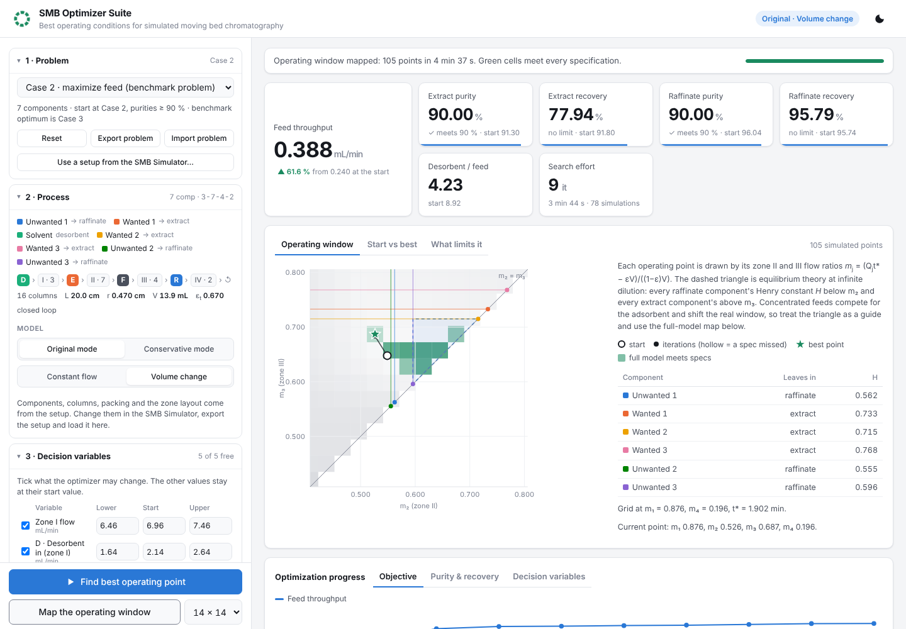
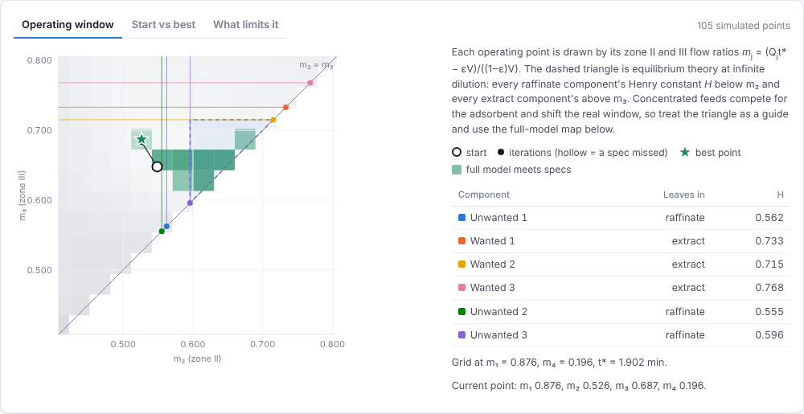

# SMB Optimizer Suite

[](https://github.com/YC-Leo/SMB-optimizer/actions/workflows/tests.yml)
[](LICENSE)
[](https://www.python.org/downloads/)

Finds the **best operating conditions** for a **simulated moving bed (SMB)** chromatography unit: the zone flows, port flows and switch time that give the most feed throughput, or the least desorbent use, while the extract and raffinate meet their purity and recovery specifications.

Every candidate operating point is simulated with the full SMB model to cyclic steady state, so the optimum respects mass transfer, axial dispersion, competitive adsorption and density-driven volume change, not just equilibrium theory. It runs on an ordinary laptop with Python, NumPy and SciPy; no commercial solver, licence or sparse linear-algebra library is needed.

This is the companion to the [SMB Simulator Suite](https://github.com/YC-Leo/SMB-simulator), which runs one operating point and shows the unit in motion. The optimizer uses the same simulation engine (`smbsim/`) and reads and writes the same setup files.





## Quick start

You need Python 3.9 or newer.

| System | How to start |
|---|---|
| Windows | Double-click `launch_windows.bat` |
| macOS / Linux | Run `./launch_mac_linux.sh` |
| Any | Run `python -m pip install -r requirements.txt` once, then `python run_suite.py` |

The suite opens at <http://127.0.0.1:8051> (the simulator uses 8050, so both can run side by side). Everything runs locally.

Three example problems are built in:

| Problem | What it asks |
|---|---|
| **Case 2 · maximize feed (benchmark problem)** | 7 components. Start at the Case 2 operating point and find the largest feed for which the extract and raffinate group purities stay at or above 90 %. Its benchmark optimum is Case 3 of the simulator. |
| **Case 2 · minimize desorbent** | Same unit and specifications at a fixed feed, using as little desorbent as possible. |
| **Case 1 · maximize feed** | 3 components. Largest feed with extract purity at or above 98 % and both recoveries at or above 99 %. The start point misses the purity, which shows how the search recovers from an infeasible start. |

Press **Find best operating point**. The benchmark problem needs about 75 cyclic-steady-state simulations; that took 2–3 minutes on a 2-core cloud machine using one process, and is faster on a recent laptop with several processes.

## Setting up a problem

The setup panel is grouped in the order the problem is defined.

1. **Problem**: load an example, export or import a problem as JSON, or start from a setup exported by the SMB Simulator Suite.
2. **Process**: the unit itself: components, columns, packing and zone layout come from the setup. The numerical mode and flow model can be switched here.
3. **Decision variables**: the zone I flow, every port flow except the balance outlet, and the switch time. Tick the ones the optimizer may change and give each a lower bound, start value and upper bound. The balance outlet flow follows from the liquid balance.
4. **Objective**:
   - maximize feed throughput
   - minimize desorbent use (desorbent / feed)
   - maximize extract or raffinate purity or recovery
5. **Limits**:
   - minimum extract and raffinate purity and recovery (group values, desorbent-free)
   - the largest flow allowed in any zone, which stands for the pressure-drop limit, and the smallest, which keeps every zone and the balance outlet flowing
   - optionally, a maximum desorbent-to-feed ratio
6. **Solver**: iteration limit, steady-state tolerance, gradient step and the number of parallel processes.

## What you get

- **KPIs**: the objective at the best point and its change from the start, each purity and recovery against its specification, desorbent use and the search effort.
- **Operating point** (tabs):
  - **Operating window**: the path of the search in the (m₂, m₃) plane. The equilibrium-theory triangle is drawn as a guide. **Map the operating window** simulates a grid of (m₂, m₃) points with the full model and colours the cells that meet every specification.
  - **Start vs best**: every decision variable, zone flow, m-value, purity and recovery before and after, with each variable's position between its bounds.
  - **What limits it**: which limits are binding at the optimum and what relaxing each by one unit would be worth, for example the extra feed allowed by one percentage point less extract purity.
- **Optimization progress** (tabs): the objective, the purities and recoveries against their specifications, and the decision variables, iteration by iteration. Points that miss a specification are hollow.
- **Cyclic steady state**: the axial concentration profile and where each component leaves the unit, at the best point or the start.
- **Run history**, with downloads of the best setup (open it in the SMB Simulator Suite to watch the unit run) and of the iterations as CSV.

## How it works

### Every evaluation is a cyclic steady state

The objective and the purity and recovery constraints are only defined at cyclic steady state (CSS), so every evaluation means switching the unit until it repeats itself. Three things make that affordable on a laptop:

1. **Accelerated CSS.** The CSS is the fixed point of the switch map *x = G(x)*: integrate one switching period, then re-index the columns by one. Plain repetition converges slowly because some modes decay by only a few per cent per switch. Anderson mixing of the last 12 iterates cuts the number of switches by a factor of 3–5. (It must not clip slightly negative concentrations at zero: the central-difference grid has small negative values at steady state, and clipping stalls the iteration.)
2. **Batched simulation.** The current point and one slightly changed copy per decision variable differ only in flows and switch time. `BatchSimulator` stacks them along an extra array axis and integrates them with exactly the same equations as the simulator (the results are bit-for-bit identical). With small grids the cost of a NumPy step is mostly fixed overhead, so six operating points cost about twice as much as one.
3. **Warm starts and parallel processes.** Every simulation starts from the CSS of the previous point, and gradient batches can be split over several processes.

### Trust-region SQP

The purities respond very nonlinearly to the flows: in the benchmark problem a 2 % change in switch time moves purity by about 35 points. A line-search SQP (SciPy's SLSQP) took a first step to the feed's upper bound, lost 30 points of purity, and then spent its time backtracking. The optimizer therefore uses a trust-region SQP on an exact L1 penalty (Sl1QP):

1. At the current point, compute the objective, the constraints and their gradients (forward differences from one batch).
2. Solve a small quadratic model of the problem, with a damped-BFGS Hessian of the Lagrangian, inside a box of size Δ around the current point. Constraint violations are allowed in the model at a penalty, so an infeasible start is not a problem.
3. Simulate the proposed point. Accept it only if the penalty merit (objective + μ · violation) improves by at least 10 % of what the model predicted.
4. Enlarge the box after good steps, shrink it after poor ones, and stop when the best step lies well inside the box and promises less than 0.01 % improvement.

Two details matter in practice. Each steady state is converged to 1e-8 g/mL per switch: at 1e-7 the purities still depend on the starting state by about 0.002 percentage point, which is enough to make a penalty method reject good steps near the optimum. And because purity is curved in the flows, a step aimed exactly at a limit tends to land just outside it; the search therefore aims 0.002 percentage point inside every product specification, and a second-order correction re-plans a step that left a curved limit.

Flow limits and feed or desorbent objectives are computed analytically, with exact gradients.

### What limits the optimum

At the optimum the gradient of the objective is a non-negative combination of the gradients of the binding limits (KKT conditions). The multipliers are estimated by non-negative least squares and converted to physical units: they say how much the objective would improve per unit of relaxation of each limit.

## Validation

`python validation/benchmark_optimum.py` solves the benchmark problem from the Case 2 operating point and compares the result with the benchmark optimum (Case 3).

| | Start (Case 2) | Optimum found here | Benchmark optimum (Case 3) |
|---|---|---|---|
| Zone I flow (mL/min) | 6.960 | **7.000** | 6.971 |
| Desorbent (mL/min) | 2.140 | **1.640** | 1.640 |
| Extract (mL/min) | 0.721 | **0.823** | 0.880 |
| Feed (mL/min) | 0.240 | **0.3874** | 0.3874 |
| Switch time (min) | 1.893 | **1.896** | 1.922 |
| Extract / raffinate purity (%) | 91.30 / 96.04 | **90.00 / 90.00** | 90.00 / 90.00 |
| m₂ / m₃ | 0.549 / 0.648 | **0.527 / 0.687** | 0.526 / 0.688 |

From the Case 2 operating point the optimizer raises the feed by 61.4 %, the same as the benchmark optimum, in 9 iterations and 66 simulations (under 3 minutes on a 2-core cloud machine with one process). Both purities end exactly on their limits, and the two optima sit at the same (m₂, m₃). The extract flow and switch time differ slightly because one zone I flow / switch time combination can be traded against another at nearly the same m-values. The binding limits are both purities, the zone I flow limit and the desorbent's lower bound.

`python validation/consistency_checks.py` then tests the optimizer itself:

| Check | Result |
|---|---|
| Both purities ≥ 88 / 90 / 92 % | best feed 0.4423 / 0.3874 / 0.3325 mL/min: monotonic |
| Value of one percentage point of purity | observed 0.0274–0.0275 mL/min feed, predicted 0.0277 by the multipliers at 90 % |
| Start at the benchmark optimum | stays there (0.3874) |
| Start from a poor point (feed 0.10, long switch) | ends at 0.3845, 0.75 % below the best |

The **Case 1** example starts outside its specification (extract purity 96.9 % against 98 %) and ends at a feed of 2.229 mL/min, 69 % above the start, with every limit met.

Full tables: `validation/benchmark_results.md`, `validation/consistency_results.md`.

### What the operating-window map shows

For the benchmark problem the full-model window lies well to the left of the equilibrium-theory triangle: the best point has m₂ = 0.53, below the Henry constants of all three raffinate components (0.555–0.596), where dilute theory would send them into the extract. At these concentrations the solutes compete for the adsorbent and displace each other, so they travel faster than the dilute theory predicts. That is why this optimizer works on the full model, and why the triangle is shown only as a guide.

## Model

The simulation engine is the one in the SMB Simulator Suite: competitive Langmuir isotherm, linear-driving-force mass transfer, axial dispersion, constant flow or density-driven volume change, and explicit port switching to cyclic steady state, in either the Original (finite-difference) or the Conservative (finite-volume) numerical mode. See that project for the equations and their validation.

The m-values are m<sub>j</sub> = (Q<sub>j</sub> t* − ε V) / ((1 − ε) V), with ε the total porosity and V the column volume. The Henry constants in the operating-window chart are the isotherm slopes at infinite dilution in the desorbent.

## Project layout

```
smbsim/              simulation engine (same as the SMB Simulator Suite)
smbopt/
  problem.py         decision variables, objectives, limits, example problems
  batch.py           batched CSS solver with Anderson acceleration
  optimizer.py       trust-region SQP, gradients, multipliers, process pool
  window.py          (m2, m3) operating-window map, Henry constants
webapp/              local web server (Python standard library) and UI
  static/            HTML/CSS/JS with hand-written SVG charts, no external libraries
run_suite.py         launcher
validation/          benchmark optimum
tests/               quick checks
```

The optimizer can also be used from Python:

```python
from smbopt import problem_preset, optimize

problem = problem_preset("case2_feed")
result = optimize(problem)
print(result["optimum"]["values"], result["optimum"]["metrics"])
```

On macOS and Windows, code that uses parallel processes must sit under `if __name__ == "__main__":`.

## Contributing

Please read [CONTRIBUTING.md](CONTRIBUTING.md) for setup instructions, test and validation commands, and pull request expectations.

## License

This project is licensed under the MIT License. See [LICENSE](LICENSE).
